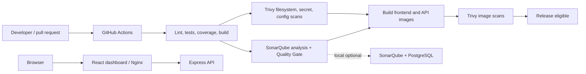

# DevSecOps CI/CD Pipeline

A runnable reference project showing how CI checks, SonarQube and Trivy can gate container builds. The dashboard is deliberately transparent: until it is connected to a CI provider and scanner results, it reports **Not run** and does not claim a clean scan or passing quality gate.

## Architecture



The CI workflow stops at eligible, scanned images. It intentionally does not deploy anywhere because no deployment target or credentials are configured. Add a deployment job that `needs: [trivy-image]` when you select a host.

## Stack

- React 18, TypeScript, Vite and Tailwind CSS
- Node.js 22, Express and TypeScript
- Vitest, Testing Library and Supertest; ESLint
- GitHub Actions, SonarQube, Trivy, Docker and Compose

## Prerequisites

- Node.js 22.13+ and npm 10+
- Docker Engine with Compose plugin (for containers and optional SonarQube)
- Git; a GitHub repository to run hosted Actions

## Run locally

```sh
npm install
npm run dev
```

Open <http://localhost:5173>. Vite proxies `/api` to the Express API on port 3001. Copy `.env.example` to `.env` only if you want to customize local values; never put credentials in frontend variables, commits, or images. `VITE_API_URL` is public browser configuration, not a place for secrets.

Run the containerized application:

```sh
docker compose up --build
```

Open <http://localhost:8080>. The API is available through Nginx at `/api/health`; only the web port is published. The backend runs as the `node` user and Nginx uses the publisher's unprivileged image on port 8080. The sample SonarQube database password is for local development only.

### Docker Desktop on Windows

The Docker CLI and Compose plugin can be installed while the Linux engine is stopped. In PowerShell, start Docker Desktop and wait for its status to show that the engine is running:

```powershell
docker desktop start
docker desktop status
docker context ls
docker context use desktop-linux
docker version
docker info
docker compose config
```

If `docker version` shows only a Client section and reports that `dockerDesktopLinuxEngine` cannot be found, the CLI cannot reach the Linux engine. Start Docker Desktop from the Start menu and wait for **Engine running**. If its Windows service is stopped, open an Administrator PowerShell and run `Start-Service com.docker.service`; then reopen Docker Desktop. In Docker Desktop, select **Settings → General → Use the WSL 2 based engine** (if using WSL 2), check **Resources → WSL Integration** for the desired distribution, and use **Troubleshoot → Restart Docker Desktop**. Retry `docker info` before running Compose. `docker compose config` validates YAML only; it does not prove an engine is running or images can build.

## Tests, lint and builds

```sh
npm ci
npm run lint
npm run coverage
npm run build
```

Vitest creates LCOV reports under `backend/coverage` and `frontend/coverage`. API tests cover health, ordered pipeline state, honest unavailable scan/quality responses and unknown routes. UI tests cover loading, fetch errors and unavailable data behavior. The repository workflow runs these same mandatory checks.

## SonarQube

Start the optional SonarQube Community server and PostgreSQL profile:

```sh
docker compose --profile sonarqube up -d sonarqube-db sonarqube
```

Visit <http://localhost:9000>, sign in with the initial `admin` / `admin` credentials and change the password. Create a project with key `devsecops-ci-cd-demo`, create a project analysis token, and configure a Quality Gate in SonarQube. Provide the token to the scanner as an environment variable; do not commit it. After generating coverage, run the scanner locally, for example:

```sh
npm ci
npm run coverage
docker run --rm --network host -e SONAR_HOST_URL=http://localhost:9000 -e SONAR_TOKEN="$SONAR_TOKEN" -v "$PWD:/usr/src" sonarsource/sonar-scanner-cli
```

On Docker Desktop for Windows/macOS, use `http://host.docker.internal:9000` for `SONAR_HOST_URL` rather than `--network host` if the host networking mode does not reach the service. On Linux, `--network host` reaches the published local port. For GitHub Actions, add repository **Settings → Secrets and variables → Actions** secrets `SONAR_HOST_URL` and `SONAR_TOKEN`. The workflow uploads analysis and then explicitly waits for SonarSource's Quality Gate action; a failed gate or missing credentials fails the job. A token alone is not a gate: the project must exist and have a configured Quality Gate.

The local SonarQube profile uses Community Edition; branch and pull request analysis features depend on the SonarQube edition and server version. Hosted CI secrets are generally unavailable to forked pull requests, so those runs will fail the mandatory Sonar job unless you deliberately use an alternative safe policy for forks.

## Trivy

The official Windows installation is the Trivy release ZIP. For PowerShell, choose the current version from the [official releases](https://github.com/aquasecurity/trivy/releases) and use its `windows-64bit.zip` asset; extract `trivy.exe` to a folder on `PATH`. Verify with `trivy --version`. The [official installation guide](https://trivy.dev/docs/latest/getting-started/installation/) lists the supported package sources. The workflow pins Trivy CLI v0.76.1; update this pin deliberately when upgrading. Then scan locally:

```sh
trivy --config trivy.yaml fs --scanners vuln --severity HIGH,CRITICAL --exit-code 1 --format json --output trivy-fs.json .
trivy fs --scanners secret --severity HIGH,CRITICAL --exit-code 1 --format json --output trivy-secrets.json .
trivy config --severity HIGH,CRITICAL --exit-code 1 --format json --output trivy-config.json .
docker compose build
docker compose images
trivy image --severity HIGH,CRITICAL --exit-code 1 --format json --output trivy-backend.json <backend-image-from-compose-images>
```

Compose-generated image names can vary; use `docker compose images` and scan the resulting backend and frontend tags. The Actions workflow scans production and development lockfile dependencies (configured in `trivy.yaml`), secrets, supported misconfigurations and both built images. Each mandatory scan uses exit code 1 at HIGH/CRITICAL, so findings and scanner/tool failures fail CI. JSON/SARIF reports are uploaded as workflow artifacts where a report was produced. Severity is controlled by `BLOCKING_SEVERITIES` in `.github/workflows/devsecops.yml` and locally with `--severity`. Do not lower it casually.

For a safe secret-scanner behavior check, use a temporary fixture generated by `scripts/test-trivy-secret.ps1`; it writes only a synthetic fake credential to a temporary folder, checks that Trivy reported a finding rather than a tool error, and removes the fixture. The repository itself contains no intentional secret fixture, so the normal blocking scan is not made to fail by test data.

Investigate reports by reviewing the package/image, installed version, fixed version, exploit context and misconfiguration. Update the direct dependency or its parent package, refresh the lockfile, rebuild and rescan. For container findings, choose a supported patched base image and rebuild regularly. `.trivyignore` is intentionally empty: if a finding requires a temporary exception, document its reason and expiry beside the exact ID, get review, and remove it when fixed. Never ignore broad classes of findings to make a gate green.

## GitHub Actions setup and gate behavior

Commit and push this project to GitHub with default branch `main`; Actions will run on pushes to `main`, pull requests targeting `main`, and manual `workflow_dispatch`. Add the two Sonar secrets above. The workflow uses immutable commit SHA pins for checkout, setup-node, artifact actions, Sonar and Trivy. Update pins deliberately and keep them current.

Mandatory check chain:

1. Lint, tests, coverage and TypeScript production builds must pass.
2. SonarQube analysis must complete and its explicit Quality Gate must pass.
3. Trivy filesystem, secret and configuration scans must execute without tool errors and produce no HIGH/CRITICAL blocking findings.
4. Only then are the two images built. Trivy scans each image; a failure blocks any subsequent release.

Examples: a failing API test blocks all dependent jobs. A SonarQube gate set to reject new bugs blocks image builds. A HIGH Trivy finding blocks the source or image scan job. A clean local report is not evidence that a hosted scan passed; inspect the actual Actions run and artifact.

## CI, delivery and deployment

- **Continuous integration** automatically checks each change through linting, tests, analysis and scans.
- **Continuous delivery** keeps changes release-ready after checks, with a human or separate release action deciding when to publish.
- **Continuous deployment** automatically publishes every change that passes the required gates.

This repository implements CI and builds scanned, eligible container images. It does not publish or deploy. To enable deployment, add credentials as GitHub secrets and a deployment job with `needs: trivy-image`; scope it to trusted branches/environments and use the hosting provider's documented action or CLI. Do not run deployments for untrusted pull request code.

## Troubleshooting

- **Port conflict:** change published ports in `docker-compose.yml` or stop the process using 3001, 5173, 8080 or 9000.
- **Dashboard says API unavailable:** confirm `npm run dev` starts both workspaces, or inspect `docker compose logs backend frontend`.
- **Sonar scanner cannot connect:** use the correct host address from the scanner container, confirm port 9000 and verify token/project key. Ensure SonarQube has finished starting.
- **Quality Gate times out/fails:** check the SonarQube background task and project gate; analysis upload without the Quality Gate check is not sufficient.
- **Trivy reports findings:** inspect the JSON/SARIF artifact and fix or review each affected package/configuration; do not interpret a missing report as a pass.
- **Docker build fails:** ensure the build context is the repository root (`.`) and Docker has network access to fetch base images and npm packages.

## Screenshots

After starting the actual app, capture the desktop overview at 1440×900 and a narrow mobile view around 390×844. Capture the visible “Demo mode” banner and Not run states before integrations are connected; capture real scan and gate results only after running and verifying those tools. Do not use mock scan figures as evidence of successful scans.

## Verification status

Checks executed on 2026-10-26. The machine's installed Node.js was v22.9.0, below Vitest 5's minimum, so npm checks were rerun with the official Node.js v22.23.3 ZIP extracted under the temporary directory.

Passed:

- `npm ci` — completed from `package-lock.json`.
- `npm run lint` — backend and frontend passed.
- `npm run coverage` — all 5 backend API tests and 3 frontend UI tests passed.
- `npm run build` — backend TypeScript and frontend Vite production builds passed. The backend output path was corrected to match the package start script and Docker CMD.
- `npm audit --audit-level=moderate` — 0 vulnerabilities.
- `docker compose config --quiet` and workflow YAML parsing with Python PyYAML — passed.
- Trivy v0.76.1 filesystem vulnerability scan, including dev dependencies, secret scan, and config scan — each exited 0 with 0 HIGH/CRITICAL findings. JSON reports are in `%TEMP%\cyber-trivy-reports`.
- `scripts/test-trivy-secret.ps1` — passed; Trivy exited 1 and reported the generated synthetic fixture, then the script removed it.
- Started the built API locally and queried `/api/health`, `/api/pipeline`, `/api/security`, `/api/quality`, and `/missing`. Health returned `ok`, pipeline/security/quality correctly returned `not_run`, and the unknown path returned 404.

The first inclusive Trivy dependency scan found two CRITICAL issues in `tinypool@1.1.1` (CVE-2026-104848 and CVE-2026-104849). Upgrading to Vitest 5 removed the affected package from the lockfile; the final inclusive scan returned zero findings. An earlier Trivy config scan found HIGH `DS-0002` in `frontend/Dockerfile`; the runtime now declares UID 101 explicitly, and the final config scan returned zero findings. No findings were ignored.

Not run or blocked:

- Docker Engine checks report Docker CLI 29.2.1 and Compose 5.0.2 installed, but `docker version`/`docker info` cannot connect to `npipe:////./pipe/dockerDesktopLinuxEngine`. Docker Desktop is installed; its Linux engine is not running or reachable. Compose YAML validation passing does not verify image builds.
- Docker image builds, Compose startup, container health checks, frontend-over-Nginx HTTP tests, and Trivy image scans remain not run until Docker Desktop reports the engine running. Start it with `docker desktop start` or the Windows steps above, confirm `docker info`, then run `docker compose up --build`.
- SonarQube startup, analysis, and Quality Gate verification remain not run. The Docker engine is unavailable; `SONAR_HOST_URL` and `SONAR_TOKEN` are not configured in this environment, and `sonar-scanner` is not installed. Sonar source/test and LCOV paths were inspected and align with the generated reports, but this does not prove a server analysis or passed gate.
- No GitHub Actions run was observed. This workspace has no `.git` directory, no GitHub CLI, and no configured remote/repository context. Workflow behavior on GitHub and negative gate scenarios are therefore not observed.
- Deployment is not configured. The dashboard/API remain explicitly simulated for pipeline, Trivy, and Sonar results; no GitHub Actions, scanner, or Sonar server integration populates them.
